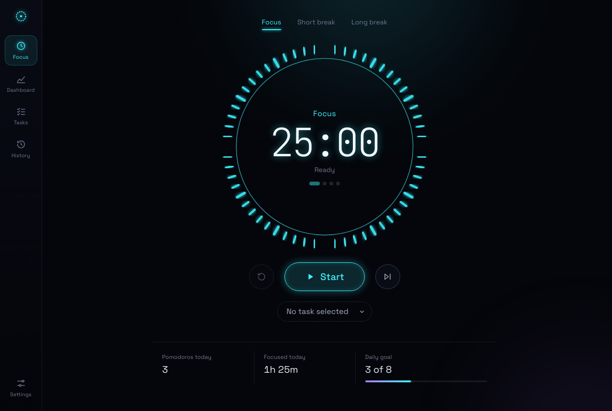
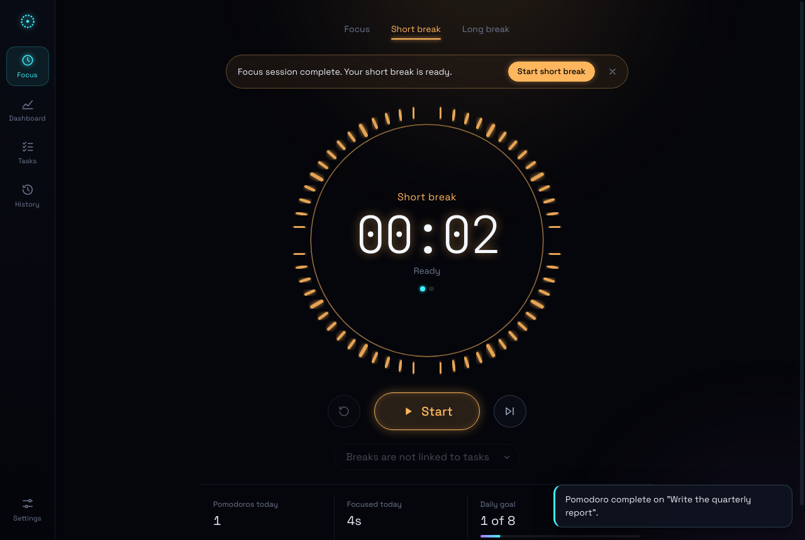
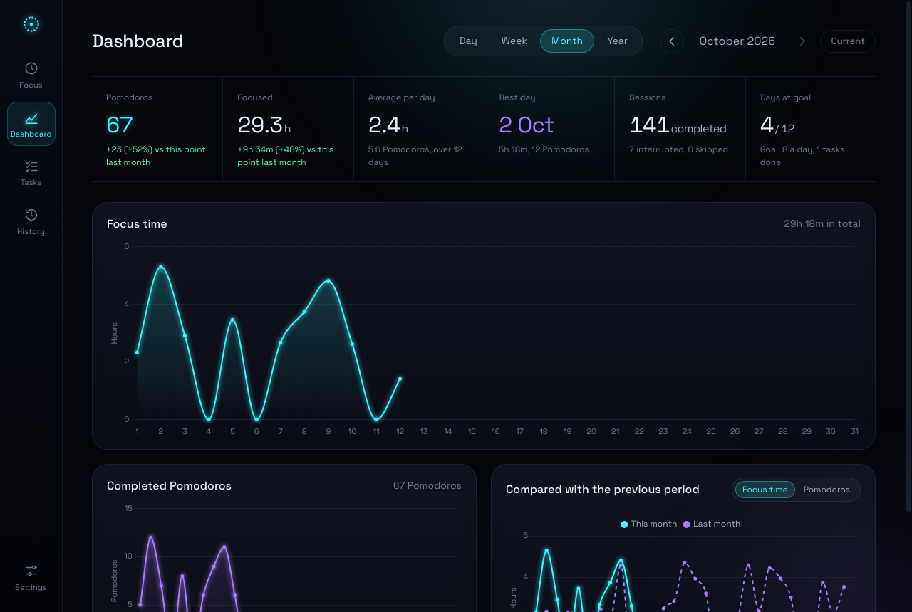
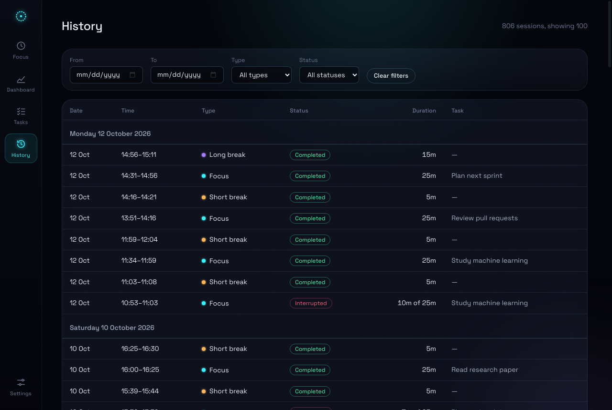

# Focus Neon

A desktop Pomodoro timer and productivity tracker. It has a neon interface, a SQLite history and interactive charts.



- **Focus timer**: 25/5/15 defaults with the standard 4-session cycle. You can start, pause, resume, reset and skip. The dial is a ring of 60 light tubes that switch off as time runs down. Dots under the clock show your place in the cycle.
- **Alarms**: a sound plays at the end of every focus session and every break. There are four sounds, with a volume setting and an on/off switch. You also get a system notification.
- **Tasks**: create, edit, delete and complete tasks. You can estimate a task in Pomodoros and see "2 of 4" progress, time spent and session history. Finishing a Pomodoro never completes a task by itself.
- **Steps**: break a task into steps, Microsoft To Do style. Click **+ Add steps** under a task, type, and press Enter to add the next one (Esc closes the field). Tick a step to complete it, click its name to rename it, and use × to delete it. "5 of 6 steps" with a small bar shows progress and collapses or expands the list. Steps are saved with their task and deleted with it.
- **Dashboard**: day, week, month and year views, with arrows to move through past periods. It shows key figures, three interactive line charts (focus time, completed Pomodoros, and a comparison with the previous period) and clear empty states.
- **History**: every completed, interrupted and skipped session with exact start and end times. You can filter by date, type and status.
- **Settings**: durations, cycle length, auto-start, alarm, daily goal, week start, accent colour, glow, reduced motion and a menu-bar countdown. Data tools let you export to CSV, back up the database, **import a backup**, show the database file and delete everything.
- **Menu bar / tray**: shows the live countdown (on macOS) and has quick controls. Closing the window keeps the timer running.

| Session complete | Dashboard (month) | History |
| --- | --- | --- |
|  |  |  |

---

## Install and run

> **Don't open `src/index.html` directly.** It is only the app's interface. The timer, the SQLite database and the charts run inside the Electron desktop app, so opened in a browser nothing responds (the page now tells you so).

**Easiest:** install [Node.js LTS](https://nodejs.org), then double-click the launcher in this folder:

- macOS: `Start Focus Neon.command` (the first time, right-click → **Open** if macOS warns about an unidentified developer)
- Windows: `Start Focus Neon.bat`
- Linux: `./start.sh`

The first launch runs `npm install` (about a minute). After that, it opens straight away.

**Or from a terminal:**

Requirements: **Node.js 22 LTS** (20 also runs the app; the test runner needs 22) and npm. No compiler or Python is needed, because there are no native modules.

```bash
cd focus-neon
npm install          # downloads Electron and the libraries
npm start            # opens the app
```

Other ways to run it:

```bash
npm run start:fast   # 1 minute = 1 second, separate temporary data folder; good for trying the alarms
npm run demo         # separate DEMO database with ~10 weeks of generated sessions to explore the dashboard
```

Neither of these touches your real data. They use their own folders in your system's temp directory.

### Keyboard shortcuts

| Key | Action |
| --- | --- |
| `Space` | Start / pause / resume |
| `R` | Reset the current session |
| `S` | Skip to the next session |
| `Ctrl`/`⌘` + `1`–`5` | Focus, Dashboard, Tasks, History, Settings |

## Tests

```bash
npm test             # 39 unit tests: timer rules, duplicates, sleep, restart, statistics, DST, SQL injection, steps, import, migration
npm run test:e2e     # drives the real app: sessions, alarms, tasks, history, dashboard, restart, crash recovery
```

On a Linux machine without a display, run the end-to-end test as `xvfb-run -a npm run test:e2e`.

## Build a desktop installer

```bash
npm run dist:mac     # .dmg and .zip   (run on macOS)
npm run dist:win     # installer and portable .exe   (run on Windows)
npm run dist:linux   # AppImage and .deb
```

Installers are written to `dist/`. Build each platform on that platform. macOS builds are unsigned unless you set up an Apple Developer certificate. Without one, macOS asks you to confirm the first launch (right-click the app, then **Open**).

---

## Where your data lives

A single SQLite file named `focus-neon.sqlite` in the app's data folder:

| OS | Folder |
| --- | --- |
| macOS | `~/Library/Application Support/Focus Neon/` |
| Windows | `%APPDATA%\Focus Neon\` |
| Linux | `~/.config/Focus Neon/` |

**Settings → Data → Show database file** opens the folder. The file is a standard SQLite 3 database, so DB Browser for SQLite, `sqlite3` and Python can all open it. Every write is saved atomically: the app writes a temporary file, flushes it to disk, then renames it. A crash therefore can't leave a half-written database. If the file is ever damaged, the app keeps it as `.corrupt-<timestamp>`, starts a fresh one and tells you.

### Restoring a backup (Import database)

**Settings → Data → Import database** restores a file made with **Back up database**. This works after a reinstall, after resetting the computer, or on another machine. Backups made by older versions (including those saved under the previous name, Neon Pomodoro) are accepted and upgraded automatically.

1. Before anything changes, the file is checked in memory. It must be a SQLite database that passes an integrity check, has Focus Neon's tables and structure, and was not made by a newer version. Anything else is refused with an explanation, and your data is left untouched.
2. You see what the backup contains (tasks, steps, sessions, dates) and confirm that it will replace your current data.
3. A safety copy of your current data is saved to `backups/focus-neon-before-import-<date-time>.sqlite` inside the data folder.
4. The database is swapped in one atomic step. If the write fails, the previous database stays exactly as it was.

Import is not available while a session is running or paused, so finish or reset it first.

### Upgrading from Neon Pomodoro

The app used to be called Neon Pomodoro and kept its data in a `Neon Pomodoro` folder. On first start, Focus Neon copies that database into its own folder automatically. The original file is left where it was.

### Schema

| Table | Purpose |
| --- | --- |
| `tasks` | `id, title, description, estimated_pomodoros, status (active/completed), created_at, updated_at, completed_at` |
| `sessions` | `id, run_id (UNIQUE), task_id → tasks ON DELETE SET NULL, task_title (snapshot), session_type (focus/short_break/long_break), planned_duration_seconds, actual_duration_seconds, started_at, ended_at, status (completed/interrupted/abandoned), completed` |
| `task_steps` | `id, task_id → tasks ON DELETE CASCADE, title, completed, position, created_at, updated_at, completed_at` (schema version 2) |
| `settings` | `id, setting_key (UNIQUE), setting_value (JSON), updated_at` |
| `active_session` | the one in-flight session (at most one row), so it survives restarts |
| `app_state` | position in the Pomodoro cycle and the selected task |

Timestamps are ISO-8601 UTC. They are converted to local time for display and for day, week, month and year boundaries. Indexes cover the date-based queries. CHECK constraints enforce valid types and statuses, and require that a completed session's duration equals its planned duration. Every query is parameterised.

## How counting works

- **Pomodoro**: a completed focus session. It is counted once, on the day it ended.
- **Breaks** are recorded and play the alarm, but never count as Pomodoros or focus time.
- **Reset** saves the session as *interrupted*. **Skip** saves it as *skipped* (`abandoned` in the database). Neither counts as completed. Sessions stopped within the first second aren't saved.
- **Focus time** includes every second actually spent in focus mode, including sessions you stopped early. A session that crosses midnight or an hour boundary is split between the two.
- **Comparisons** for a period still in progress use the same elapsed part of the previous period. For example, Monday to Wednesday is compared with last Monday to Wednesday, not with all of last week.
- **Deleting a task** keeps its sessions in your history and statistics, labelled with the task's name.
- All statistics are computed from the `sessions` table on demand. Nothing is stored as a separate counter.

## Timer reliability

The timer runs in Electron's main process, not in the page. Switching pages, closing the window or minimising never affects it.

- **Time comes from timestamps.** Remaining time is always `planned − (elapsed before pause + now − resumed_at)`. The periodic tick only *checks* the clock, so a late tick can't make the timer drift.
- **Completion happens exactly once.** Three guards ensure this: an in-memory lock, a single transaction that deletes the active row and inserts the session, and a `UNIQUE(run_id)` constraint.
- **One timer at a time.** The app only runs a single instance, and the database allows at most one active session.
- **Sleep.** When the computer goes to sleep, the session pauses at that moment. If the clock jumps forward without a sleep event (for example, the process was frozen), the session also pauses at the last moment the app saw it running. In both cases a banner explains what happened. Time the app can't vouch for is never counted.
- **Restart or crash.** A running session is restored as *paused* at its last heartbeat (saved every 5 seconds). It completes on its own only if the heartbeat proves the full time had already run out while the app was open.

## Project structure

```
electron/        main.js (window, app:// protocol, tray, sleep), preload.js (safe API), ipc.js, tray.js, legacy-data.js
core/            timer-engine.js, stats.js, services.js, settings-schema.js
core/database/   database.js (migrations, import validation), schema.sql, migrations/, repositories/ (settings, tasks, steps, sessions, state)
src/             index.html, styles/*.css, js/*.js (app, navigation, timer, dashboard, charts, tasks, history, settings, audio, store, ui, format)
assets/icons/    app and tray icons
scripts/         start-fast.js, demo.js
test/            unit/ (node:test), e2e/ (Playwright + Electron)
```

**Security.** The page runs sandboxed with context isolation and no Node access, under a strict Content-Security-Policy. It can only call a fixed list of named operations through `preload.js`, such as `tasks.create` or `stats.report`. The main process validates every argument before it reaches SQLite. The page cannot run SQL or touch files.

## Design notes and limitations

- **SQLite engine.** The app uses **sql.js**, the official SQLite engine compiled to WebAssembly, rather than `better-sqlite3`. This gives a real SQLite file with transactions, constraints and indexes. It also means `npm install` works on any machine without Xcode, Visual Studio Build Tools or Python, and without rebuilding native modules for each Electron version. The trade-off is that each save rewrites the file, which takes a few milliseconds at this app's scale (thousands of sessions). For a dataset many times larger, switch `core/database/database.js` to `better-sqlite3`. The rest of the code would stay the same.
- **Alarm sounds** are generated with the Web Audio API, so there are no audio files that could fail to load. The window allows autoplay and keeps running in the background, so alarms play while the app sits in the tray.
- **Notifications** use the system's notification centre. On macOS, allow notifications for Focus Neon the first time you're asked.
- **The menu-bar countdown** is shown on macOS. Windows and Linux show the time in the tray tooltip and menu instead, because the system tray there can't show text.
- **Dates and times** are shown in British English format (for example, 12 Oct, 14:30), in your computer's time zone.
